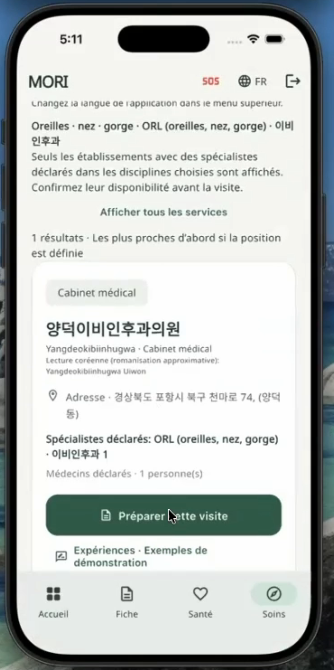
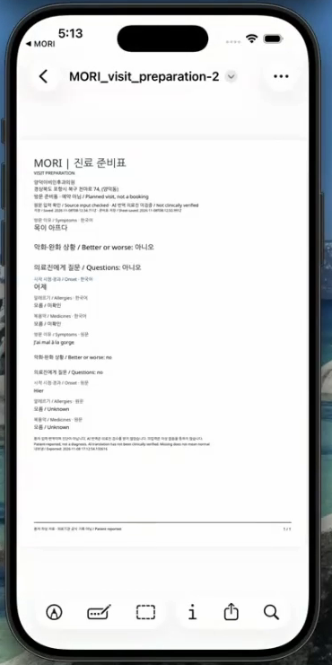
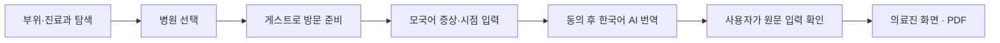
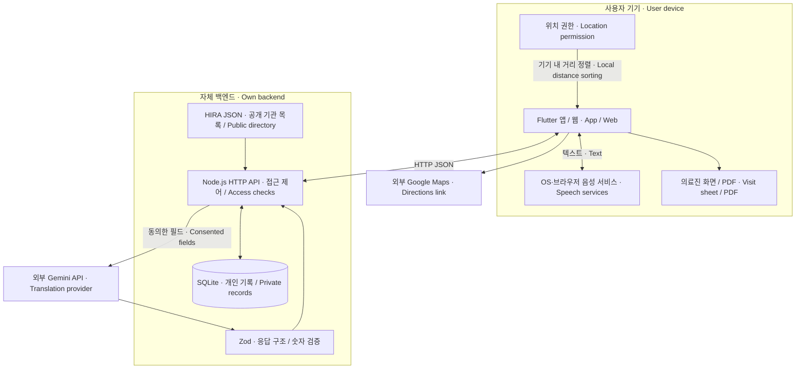
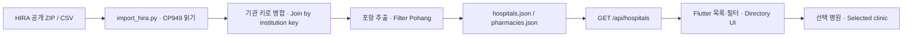
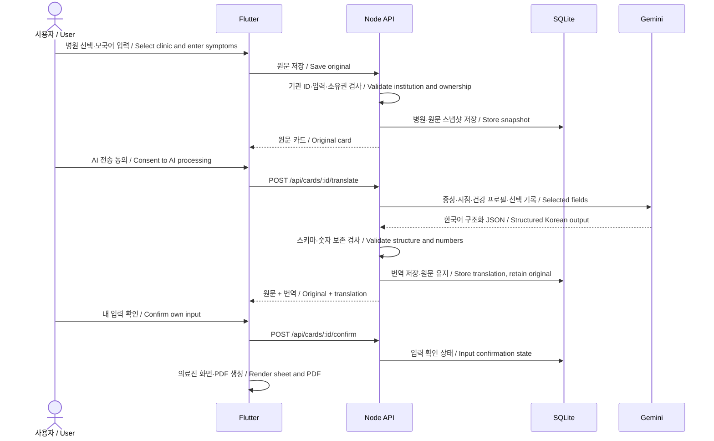

<div align="center">

# MORI · 모리
### 한국에서 아플 때, 갈 곳과 전할 말을 준비하다.
**Find a clinic. Explain your symptoms. Arrive prepared.**

Flutter · Node.js · SQLite · Gemini API<br>
2026 한동 AI·SW페스티벌 SW융합 프로젝트 · Team Puchipa

[연구보고서](docs/deliverables/MORI_research_report.pdf) · [발표자료](docs/deliverables/MORI_presentation.pptx) · [전체 ZIP 다운로드](https://github.com/shintaehyeon/mori--SW-festival-2026-/releases/tag/v1.0.0-portfolio) · [Figma](https://www.figma.com/slides/uZZqmZ1nsJT1g0J8KXBlL6)

</div>

---

## 왜 만들었나요?

> “한국에서 아프면 어느 병원에 가야 할지 모르겠고, 병원에 가도 내 증상을 설명하기 어렵다.”

한국에 유학 온 프랑스인 팀원 Caroline의 실제 경험에서 시작했습니다. **병원을 찾는 일과 진료실에서 말을 전하는 일은 하나의 여정**입니다. MORI는 두 단계를 연결해, 선택한 병원과 자신의 증상이 담긴 한국어 방문 준비표를 만들어 줍니다.

첫 사용자는 **한동대학교 외국인 유학생**입니다. 현재 병원 데이터는 **포항**에 집중하며, 비응급 방문을 준비하는 시제품입니다.

## 앱으로 무엇을 할 수 있나요?

<table>
<tr><th>01 · 병원 찾기</th><th>02 · 내 언어로 말하기</th><th>03 · 의료진에게 보여주기</th></tr>
<tr>
<td align="center"></td>
<td align="center"></td>
<td align="center"></td>
</tr>
<tr><td>부위·진료과로 탐색하고 방문할 병원을 선택합니다.</td><td>증상과 시작 시점을 말하거나 직접 입력합니다.</td><td>한국어 번역과 원문을 함께 보여주고 PDF로 저장합니다.</td></tr>
</table>

*2026-11-08 팀 시연 영상에서 발췌한 실제 화면입니다. 가상 증상을 이용한 기능 시연이며 실제 환자의 진료 기록이 아닙니다.*

### 핵심 경험: “이제 병원에서 보여줄 수 있다”



- **가입 장벽을 낮췄습니다.** 게스트로 핵심 준비표 흐름을 이용할 수 있습니다.
- **아플 때의 입력 부담을 줄였습니다.** 버튼·직접 입력·음성 입력을 함께 제공합니다.
- **방문 맥락을 유지합니다.** 선택한 기관의 공식 ID를 검증하고 병원명·주소를 준비표에 보존합니다.
- **언어를 몰라도 확인할 수 있게 했습니다.** 사용자는 자신의 원문 정보를 확인합니다. ‘사용자 입력 확인’과 ‘AI 번역·의료진 미검증’을 구분합니다.
- **결과물은 간결하게 만듭니다.** 짧은 사례는 기본 한 장, 긴 내용과 선택 기록은 추가 페이지로 출력합니다.

## 무엇을 직접 설계·구현했나요?

| 문제 | 설계 결정 | 구현 |
|---|---|---|
| 한국 진료과가 낯설다 | 신체 부위와 진료과를 탐색의 입구로 사용 | 진료과 필터·기관 목록·한국어 및 로마자 검색 |
| 아픈 상태에서 입력이 부담된다 | 필요한 정보부터 묻고 상세 항목은 선택 | 모리 질문·버튼 선택·STT·질문 읽기 |
| 번역 과정에서 정보가 사라질 수 있다 | 원문 보존과 구조 검증 | Zod 스키마·숫자 보존 검사·확인 후 재번역 보호 |
| 병원 선택 뒤 흐름이 끊긴다 | 게스트부터 준비표까지 연결 | 병원 스냅샷·게스트 세션·한국어 준비표 |
| 기능이 많아 목적이 흐려진다 | 제출 핵심 경로에 집중 | 튜토리얼·커뮤니티 기본 진입 숨김, 워치 등 후속 과제로 분리 |

**자동 진단·진료과 판정·예약·실시간 통역은 제공하지 않습니다.** 부위 탐색은 진단을 대신하지 않으며 준비표는 의료기관의 공식 문진표가 아닙니다.

## 한눈에 보는 구조 · Architecture at a glance

**한국어:** 앱은 입력·표시·PDF 생성을 맡고, 자체 서버는 계정/게스트 접근 제어·저장·AI 호출을 맡습니다. 공개 병원 목록과 개인 방문 준비 데이터는 서로 다른 경로로 처리합니다.

**English:** The app handles input, presentation and PDF creation. Our backend handles account/guest access, persistence and AI requests. The public clinic directory and private visit records follow separate data paths.



### 1. 병원 데이터 파이프라인 · Clinic data pipeline



**한국어:** 원본 파일의 기본·시설·진료과 정보를 암호화요양기호로 결합하고 포항 기관만 추출합니다. 가공한 JSON을 서버가 읽어 앱에 제공합니다. 앱은 진료과 필터·이름 검색을 제공하며 위치 허용 시 기기에서 직선거리순으로 정렬합니다. **배치 가공한 스냅샷**이므로 병원 영업 상태나 현재 진료 가능 여부를 실시간으로 수집하지 않습니다.

**English:** The importer joins basic, facility and department records using the source institution key, then extracts Pohang institutions. The backend serves the processed JSON directory. The app provides department filters and name search, with on-device straight-line distance sorting when location is granted. This is a **batch-processed snapshot**, not a live feed of opening hours or appointment availability.

> **업데이트 / Updates:** 원본 갱신 후 import 스크립트를 다시 실행해야 합니다. 자동 갱신 스케줄러는 없습니다. / A new source snapshot requires rerunning the importer; no scheduled refresh is configured.

### 2. 증상이 준비표가 되는 과정 · From symptoms to a visit sheet



**한국어:** 번역보다 원문 저장이 먼저입니다. API는 선택한 병원 ID를 공개 목록과 대조해 병원명·주소를 보존합니다. 동의 후 Gemini가 번역하고 서버가 응답 구조와 숫자를 검사합니다. 실패하면 원문을 유지하며, 사용자 확인 이후 재번역으로 덮어쓰지 못하게 보호합니다. 사용자는 자신이 입력한 내용을 확인하며 한국어 번역의 임상적 정확성을 인증하는 것은 아닙니다.

**English:** The original is saved before translation. The API validates the selected clinic ID against the public directory and preserves its name and address. After consent, Gemini translates selected fields and the server checks the response structure and numerical fidelity. Failures preserve the original; confirmed records are protected against retranslation. Users confirm their own input, not the clinical accuracy of Korean translations.

### 3. 데이터가 어디로 가나요? · Data boundaries

| 데이터 / Data | 처리 위치 / Processing | 설명 / Boundary |
|---|---|---|
| 병원 목록 / Clinic directory | 공개 JSON → 서버 → 앱 / Public JSON → API → app | HIRA 스냅샷, 실시간 진료 정보 아님 / Snapshot, not live availability |
| 증상·시점·건강 프로필·선택 기록 / Symptoms, onset, health profile, selected records | SQLite; 동의 후 Gemini / SQLite; Gemini after consent | 원문 보존 / Original retained |
| 병원명·주소 / Selected clinic name and address | 준비표 스냅샷 / Visit snapshot | Gemini 번역 요청에서 제외 / Excluded from translation payload |
| 선택한 이름·연락처 등 / Optional identity and contact details | 앱의 준비표·PDF / App sheet and PDF | 별도 내보내기 선택; AI 요청에 추가하지 않음 / Explicit export selection; not added to AI payload |
| 음성 / Audio | 기기·브라우저 음성 서비스 / Platform speech service | 제공업체가 온라인 처리할 수 있음; MORI 서버에는 음성 파일 저장 안 함 / Provider may process online; MORI does not store audio files |
| 현재 위치 / Current position | 앱 거리 계산 / App distance calculation | 직선거리이며 이동시간 아님 / Straight-line distance, not travel time |
| API 키 / API key | 서버 환경변수 / Server environment | 클라이언트·Git·ZIP에서 제외 / Excluded from client, Git and ZIP |
| PDF | Flutter에서 생성 / Generated in Flutter | 브라우저 다운로드 또는 OS 공유 / Browser download or OS share |

### 코드에서 찾아보기 · Code map

| 책임 / Responsibility | 구현 위치 / Source |
|---|---|
| 공공자료 가공 / Public data import | [scripts/import_hira.py](scripts/import_hira.py) |
| 병원·약국 스냅샷 / Directory snapshots | [server/resources](server/resources) |
| API·권한·카드 저장 / API, ownership, cards | [server/src/app.js](server/src/app.js) · [db.js](server/src/db.js) |
| 번역·숫자 및 구조 검증 / Translation and validation | [ai.js](server/src/ai.js) · [validation.js](server/src/validation.js) |
| 병원 목록·거리 정렬 / Clinic UI and distance sorting | [app/lib/hospitals.dart](app/lib/hospitals.dart) |
| 음성 질문과 답변 / Voice questions and answers | [app/lib/voice_answer.dart](app/lib/voice_answer.dart) |
| 준비표·PDF / Visit sheet and PDF | [visit_sheet_page.dart](app/lib/visit_sheet_page.dart) · [visit_pdf.dart](app/lib/visit_pdf.dart) |

**현재 외부 연결 / Current integrations:** Gemini REST API, 기기 음성 서비스, Google Maps 외부 길찾기 링크. / Gemini REST API, platform speech services and external Google Maps directions links.

**준비 단계 / Prepared, not fully configured:** Google OAuth 로그인·내부 Google 지도. Firebase는 사용하지 않습니다. / Google OAuth sign-in and embedded Google Maps require configuration. Firebase is not used.

[오픈소스·API·언어 선정 / Technology and language choices](docs/deliverables/TECHNOLOGY_AND_LANGUAGES.md) · [질문 항목의 근거 / Question sources](docs/VISIT_QUESTION_SOURCES.md)

## 데이터와 연구 근거

- 병원 정보: 건강보험심사평가원 [전국 병의원 및 약국 현황](https://www.data.go.kr/data/15051059/fileData.do)의 2026-09-30 스냅샷을 가공했습니다. 포항 의료기관 669곳·약국 237곳을 보관합니다. 화면의 필터에 따라 표시 수가 달라집니다.
- 신고 진료과와 전문의 수를 구분합니다. 실시간 진료 가능 여부·병상·외국어 대응을 보장하지 않습니다.
- 연구보고서는 공개 통계·학술논문·공공기관 안내 12건을 바탕으로 문제와 설계를 연결합니다. 전국 유학생 규모와 특정 지역 표본의 조사 결과를 구분합니다.
- UI 언어: 한국어·영어·중국어(간체)·일본어·베트남어·프랑스어. 전체 원어민 품질 검수와 모든 기기의 음성 지원 검증은 완료하지 않았습니다.

[연구 본문](docs/research/MORI_research_report.md) · [참고문헌과 사용 범위](docs/research/출처목록.md) · [도표 원자료](docs/research/도표원자료.csv) · [공공데이터 가공](reference-data/README.md)

## 검증한 것과 남은 것

최신 자동 검사 결과는 [공개 릴리스 점검](docs/PORTFOLIO_RELEASE.md)에 기록합니다. 아래 수동 검사는 [2026-11-08 QA 기록](docs/FINAL_QA_20261108.md)에 근거합니다.

| 범위 | 확인 상태 |
|---|---|
| 프랑스어 가상 증상 → 실제 Gemini 번역 → 병원 포함 준비표 | 수동 여정 확인 |
| 웹 PDF 다운로드 | 확인, [가상 예시 PDF](docs/examples/MORI_final_qa_fr.pdf) |
| 웹·iOS 시뮬레이터 빌드 | 이전 QA에서 성공 |
| 시뮬레이터 음성 입력·상태 표시 | 이전 QA에서 확인; 기기·언어별 정확도는 별도 |
| 실물 GPS·내부 지도·Google OAuth | 미검증 / 설정 필요 |
| 독립 사용자 평가·의료진 유용성·치료 효과 | 미검증 |

무료 AI 시연에는 가상 데이터를 사용합니다. 실제 건강정보를 처리하는 공개 서비스로 확장하려면 데이터 이용 조건·동의·보관·보안 검토와 번역 품질 평가가 필요합니다. 긴급 안내는 119/112 전화 화면 연결이며 실제 발신 테스트는 하지 않았습니다.

## 로컬에서 실행하기

필요 환경: Flutter SDK(Dart 3.11.1 이상 호환), Node.js 22.13 이상. 실제 AI 번역에는 본인의 Gemini API 키가 필요합니다. 데이터베이스·API 키·테스트 계정은 포함하지 않습니다.

```sh
git clone https://github.com/shintaehyeon/mori--SW-festival-2026-.git
cd mori--SW-festival-2026-
cd app
flutter pub get
flutter build web --no-wasm-dry-run
cd ../server
npm ci
cp .env.example .env
# .env의 GEMINI_API_KEY와 사용 가능한 GEMINI_MODEL을 설정
npm run dev
```

브라우저: **http://localhost:8790/**. 웹은 같은 서버의 API를 사용합니다.

네이티브 앱은 별도 터미널에서 `cd app` 후 `flutter run --dart-define=API_URL=http://127.0.0.1:8790`으로 실행할 수 있습니다(iOS 시뮬레이터 기준). 실제 휴대폰은 PC의 접근 가능한 주소가 필요하며 Android 에뮬레이터는 호스트 주소가 다릅니다. 기존 QA 서버 8791과 기본 개발 서버 8790을 혼동하지 마세요.

[Gemini 설정](docs/GEMINI_SETUP.md) · [Google Maps 설정](docs/GOOGLE_MAPS_SETUP.md) · [Google 로그인 설정](docs/GOOGLE_SIGN_IN_SETUP.md)

```sh
# server 디렉터리
npm test
# app 디렉터리
flutter analyze
flutter test
```

## 자료 모음

| 자료 | 링크 |
|---|---|
| 최종 연구보고서 · 13쪽 | [PDF](docs/deliverables/MORI_research_report.pdf) |
| 최종 발표자료 · 16장 | [PPTX](docs/deliverables/MORI_presentation.pptx) |
| 공동 발표 대본 · 영어 / 한국어 | [PDF](docs/presentation/MORI_joint_script_EN_KO.pdf) |
| 언어별 참고 대본 | [영어](docs/presentation/MORI_narration_EN.pdf) · [프랑스어](docs/presentation/MORI_narration_FR.pdf) · [한국어](docs/presentation/MORI_narration_KO.pdf) |
| 편집 가능한 발표 디자인 | [Figma Slides](https://www.figma.com/slides/uZZqmZ1nsJT1g0J8KXBlL6) |
| 소스·문서·PPT 전체 패키지 | [GitHub Release](https://github.com/shintaehyeon/mori--SW-festival-2026-/releases/tag/v1.0.0-portfolio) |

시연 영상은 팀에서 제작·업로드했습니다. 이 저장소에는 확인된 YouTube URL을 아직 등록하지 않았습니다. 문서 내 이전 날짜의 설명은 개발 이력이며 현재 기능은 이 README와 최신 QA를 기준으로 읽어 주세요.

## 팀과 기여

| 팀원 | 기여 |
|---|---|
| **신태현** · 개발 | Flutter 앱·자체 API·데이터 연결·AI 번역·PDF 여정 구현 및 QA |
| **Caroline Odette Marie David** · 문제 정의·기획·발표 | 실제 유학생 경험 제공, 사용자 관점 기획·시연과 발표 |

개발·문서 작성에는 AI 코딩·디자인 도구를 활용했습니다. 프로젝트의 범위 결정, 통합과 검증 과정은 문서에 남겼습니다. 공개 저장소는 포트폴리오이며 학교·병원의 공식 서비스나 제휴를 뜻하지 않습니다.

## 다음 단계

1. 외국인 사용자의 무도움 과제 수행과 의료진의 준비표 검토로 효용 측정.
2. 약명·숫자·부정 표현을 포함한 언어별 번역 품질 평가.
3. 실물 기기의 음성·위치·PDF 공유 검증 및 배포 환경 보완.
4. 운영 정책과 병원 데이터 갱신 체계를 갖춘 뒤 학교·지역 확장.

워치·자동 이상 감지·커뮤니티 확장은 위 핵심 검증 이후의 별도 과제입니다.

---

제3자 패키지·글꼴·공공데이터에는 각각의 라이선스와 이용 조건이 적용됩니다. 공개 열람이 본 프로젝트 전체에 대한 별도 오픈소스 사용 허락을 의미하지는 않습니다.
